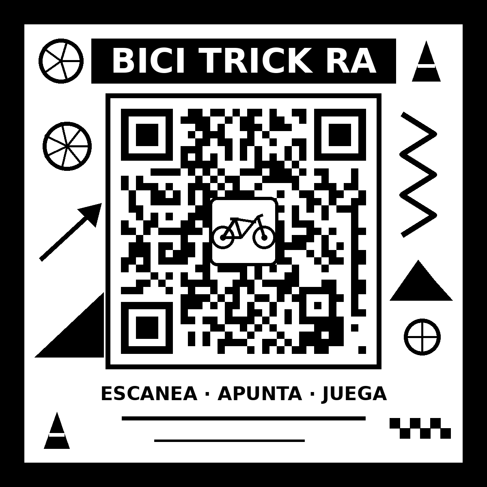

# Bici Trick RA

Minijuego de realidad aumentada para el teléfono. Al apuntar la cámara a un marcador QR de diseño propio aparece una carretera vista de lado, como un juego de plataformas, con un ciclista que tiene que brincar conos y vallas y hacer trucos en rampas antes de que se acabe el tiempo.

Funciona directo en el navegador del teléfono (Chrome en Android o Safari en iPhone), sin instalar ninguna app.

**Jugar:** https://bici-trick-ra.vercel.app/
**Marcador para imprimir:** [`marcador/marcador.pdf`](marcador/marcador.pdf)



## Cómo se juega

1. Abre el enlace en el teléfono (o escanea el QR del marcador con la cámara normal) y da permiso a la cámara.
2. Apunta al marcador impreso. La carretera aparece en la parte de abajo del marcador y se sale un poco por los lados, así que conviene alejar el teléfono o ponerlo en horizontal.
3. Presiona **JUGAR**.

| Elemento | Detalle |
|---|---|
| **Objetivo** | Recorrer 1500 m en menos de 2 minutos y medio (a toda velocidad toma unos 2 minutos). |
| **AVANZAR** (mantener presionado) | El ciclista acelera. Si lo sueltas, frena poco a poco. |
| **BRINCAR** | Salta los conos y las vallas. Las vallas son más altas, así que hay que brincar con más anticipación. Si brincas justo sobre una rampa, el ciclista da una vuelta completa en el aire (truco). |
| **Vidas** | 3. Cada choque con un cono o una valla quita una y te deja un momento sin daño (el ciclista parpadea). |
| **Puntos** | +1 por metro, +10 por cono y +20 por valla esquivados, +50 por truco (x2 si encadenas trucos sin chocar) y +5 por cada segundo que sobre al llegar. |
| **Fin de partida** | **¡META!** al llegar a 1500 m. **GAME OVER** si pierdes las 3 vidas o se acaba el tiempo. Se muestra el puntaje y el récord guardado en el teléfono. |
| **Si se pierde el marcador** | El juego se pausa y pide volver a apuntar. |

En computadora se puede probar sin cámara con [`prueba.html`](prueba.html): flecha derecha = avanzar, espacio = brincar.

### Retroalimentación táctil

- **Visual:** los botones se hunden y se iluminan al tocarlos; textos flotantes (+10, ¡TRUCO!, ¡CHOQUE!); destello rojo al chocar y dorado al hacer truco.
- **Sonido:** clic, brinco, choque, truco, meta y game over. Se generan con Web Audio, así que no usan archivos externos.
- **Vibración:** al tocar un botón, al chocar y al terminar (Android; Safari en iPhone no permite vibrar desde una página web).

## Marcador QR personalizado

El marcador es un QR real que abre el juego, con un logo de bici al centro y un marco ilustrado (ruedas, conos, rampa, pista y bandera de meta). El QR por sí solo tiene patrones muy repetidos, que es lo que hace que el seguimiento tiemble o se pierda; el marco agrega formas únicas y sin simetría que le dan a MindAR muchos puntos de referencia.

- Solo negro y blanco, para máximo contraste.
- Imprímelo en papel **mate** a unos 15 cm por lado (el PDF ya viene a ese tamaño). El papel brillante refleja la luz y rompe la detección.
- Pruébalo a 20 cm, 50 cm y 1 m, y con poca luz, para comprobar que no pierde el seguimiento.

Para regenerarlo (por ejemplo si cambia la URL del juego):

```bash
pip install qrcode pillow
python3 herramientas/generar_marcador.py https://TU-PROYECTO.vercel.app/
```

Después hay que volver a compilar `marcador/targets.mind` con el compilador oficial de MindAR: https://hiukim.github.io/mind-ar-js-doc/tools/compile (sube `marcador.png` y descarga el archivo).

## Modelos 3D

| Modelo | Autor | Licencia | Fuente |
|---|---|---|---|
| Bike | MiniPoly | [CC BY 3.0](https://creativecommons.org/licenses/by/3.0/) | https://poly.pizza/m/DN6DCPopeH |
| Traffic Cone | Quaternius | [CC0](https://creativecommons.org/publicdomain/zero/1.0/) | https://poly.pizza/m/lAx8JytxGD |
| Ramp | Quaternius | [CC0](https://creativecommons.org/publicdomain/zero/1.0/) | https://poly.pizza/m/cS1JQReXZs |
| Traffic Barrier | Quaternius | [CC0](https://creativecommons.org/publicdomain/zero/1.0/) | https://poly.pizza/m/cM3aJPU9NS |

Los archivos van en `assets/models/` con los nombres `bici.glb`, `cono.glb`, `rampa.glb` y `valla.glb` (instrucciones en [`assets/models/LEEME.md`](assets/models/LEEME.md)). Al cargarse, `js/modelos.js` los escala al mismo tamaño, los gira para que sigan la pista y los apoya en el suelo. Si un archivo falta, el juego dibuja una figura sencilla en su lugar.

## Tecnología

- [A-Frame 1.5.0](https://aframe.io/) (MIT) para la escena 3D.
- [MindAR 1.2.5](https://github.com/hiukim/mind-ar-js) (MIT) para reconocer y seguir el marcador.
- HTML, CSS y JavaScript sin compilación. Las librerías están en `lib/` para no depender de otro servidor.

Para que el modelo no tiemble, MindAR usa `filterMinCF: 0.0001` y `filterBeta: 0.001` (suavizado) y `missTolerance: 5` (aguanta unos cuadros sin ver el marcador antes de darlo por perdido). El ciclo del juego limita cada paso a 50 ms para que no haya saltos si el teléfono se traba.

## Estructura

```
index.html                 Juego con realidad aumentada
prueba.html                Mismo juego sin cámara, para probar en computadora
css/estilos.css            Interfaz, botones y animaciones
js/juego.js                Reglas, puntaje, controles y ciclo del juego
js/modelos.js              Carga y ajuste de los modelos 3D
js/sonidos.js              Efectos de sonido y vibración
js/pantallas.js            Pantallas de inicio y final, HUD y botones
marcador/                  Marcador (PNG, PDF) y archivo compilado targets.mind
assets/models/             Modelos GLB
herramientas/              Script que genera el marcador
lib/                       A-Frame y MindAR
```

## Correrlo localmente

La cámara solo funciona con HTTPS o en `localhost`:

```bash
python3 -m http.server 8000
# abre http://localhost:8000 en la computadora
```

El juego está publicado en Vercel (proyecto `bici-trick-ra`), a partir de este repositorio. Como es un sitio estático, no necesita comando de build.

## Créditos

- Modelos 3D: MiniPoly y Quaternius, vía [Poly Pizza](https://poly.pizza).
- Librerías: A-Frame y MindAR (licencia MIT).
- Marcador, sonidos y código: elaboración propia.
